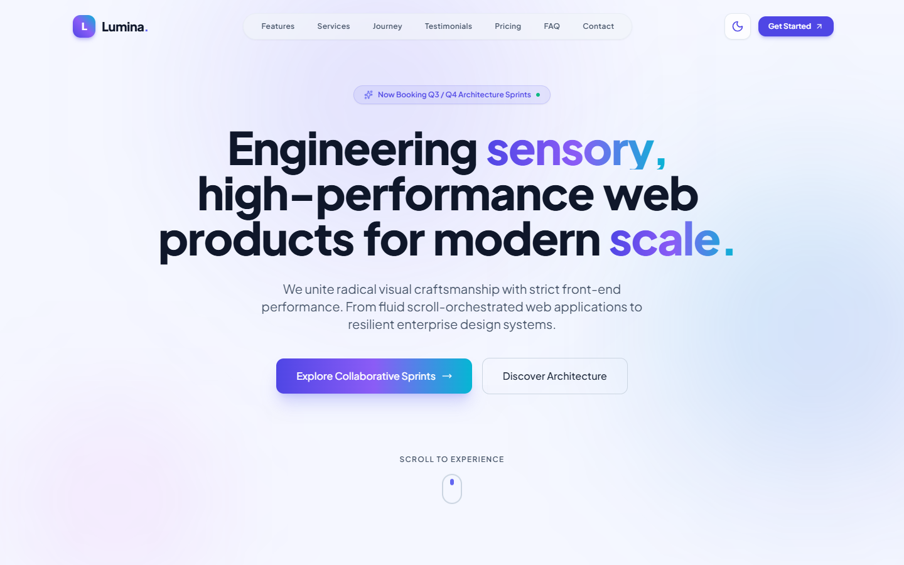
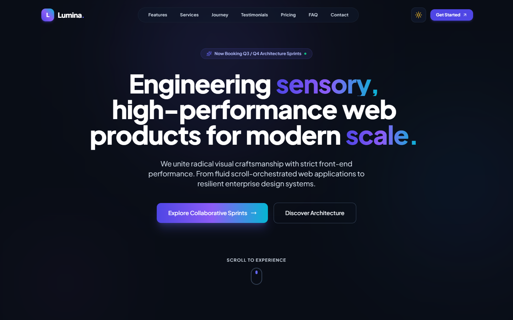
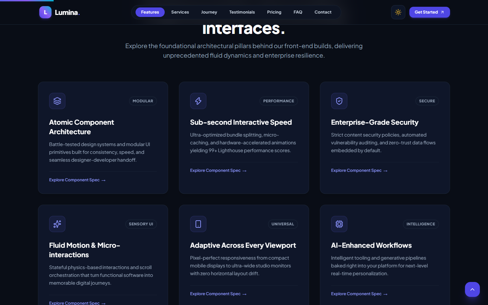
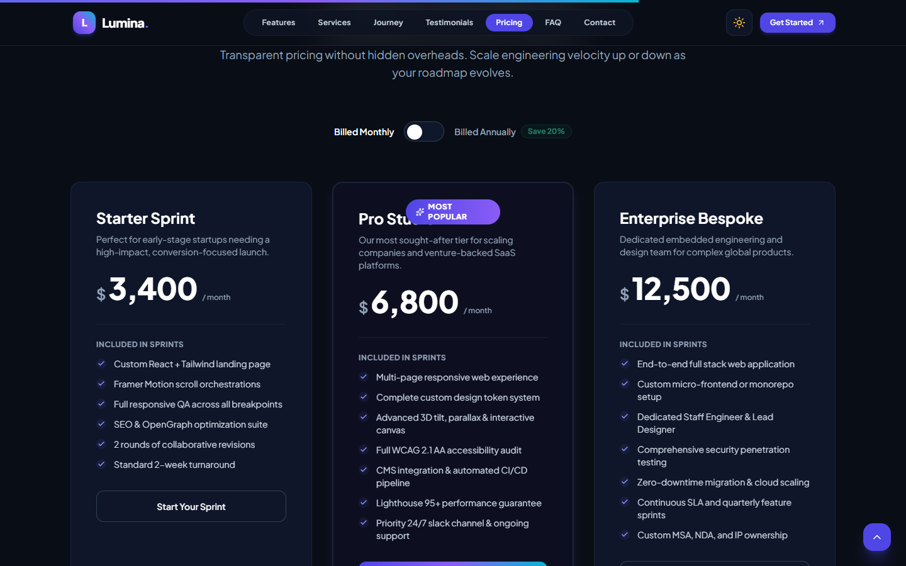
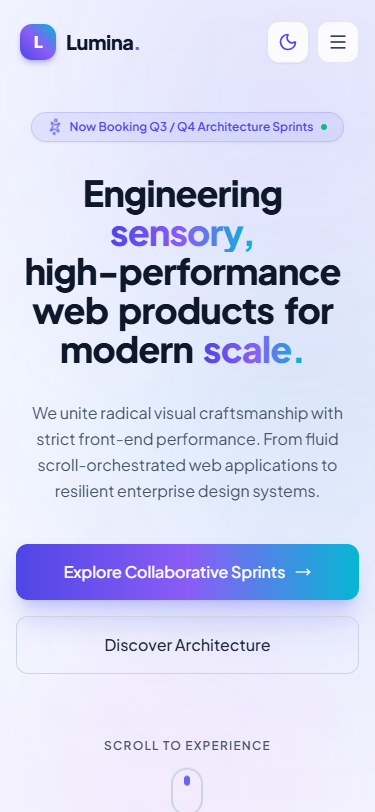
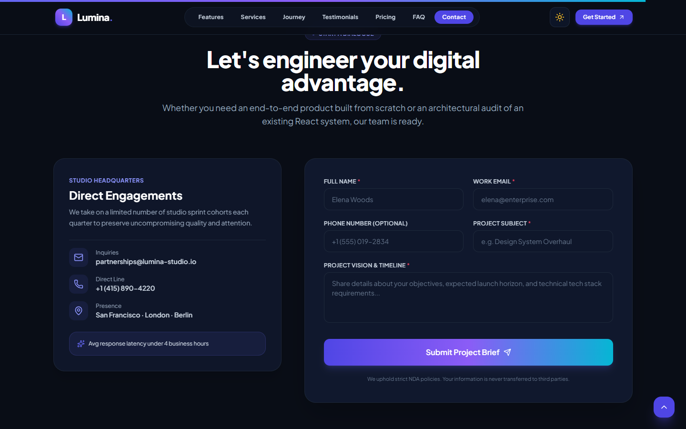

# Lumina | Next-Generation Digital Product Studio



> **Live Demo:** [https://lumina-studio.vercel.app/](https://lumina-studio.vercel.app/) *(Placeholder)*  
> **Repository:** [https://github.com/Trimurthulu44/lumina-scroll-landing-page](https://github.com/Trimurthulu44/lumina-scroll-landing-page)

Lumina is a production-ready, scroll-orchestrated landing page designed for a high-end digital product studio & SaaS venture. Engineered with **React 18**, **Tailwind CSS v3.4**, **Framer Motion**, and **Lenis Smooth Scroll**, Lumina pairs bold typography and reactive glassmorphism with hardware-accelerated animations and strict accessibility standards.

---

## 📸 Visual Showcase

| Desktop Light Experience | Desktop Dark Mode |
| :---: | :---: |
|  |  |

| Interactive 3D Tilt Features | Transparent Pricing Tiers |
| :---: | :---: |
|  |  |

| Responsive Mobile (375px) | Validated Contact Brief |
| :---: | :---: |
|  |  |

---

## ✨ Features (All 14 Core Requirements Completed)

1. **Responsive Sticky Navbar**:
   - Dynamic glassmorphism blur and subtle border when scrolling past the threshold.
   - Real-time active-section pill highlighting powered by `IntersectionObserver`.
   - Mobile animated slide-in drawer with auto-close on link selection and integrated theme toggle.
2. **Animated Hero Section**:
   - Word-by-word staggered headline reveal using spring curves and opacity shifts.
   - Dynamic floating radial gradient backdrop with glowing multi-layer parallax planes.
   - Interactive CTA buttons with micro-tap animations and a continuous scroll indicator.
3. **Lenis Smooth Scrolling**:
   - Integrated Lenis engine with customized easing curves (`Math.min(1, 1.001 - Math.pow(2, -10 * t))`).
   - Sticky navbar offset compensation for all anchor links.
   - Complete support for `prefers-reduced-motion`.
4. **Reusable Scroll Reveal Engine (`<Reveal>`)**:
   - Configurable variants: `fade-up`, `fade-left`, `fade-right`, `scale`, and `fade-in`.
   - Configured with `viewport={{ once: true }}` to eliminate repeated GPU repaints.
5. **Multi-Layer Parallax**:
   - Hero layer displacement tied to scroll progression.
   - Full-width dark **Parallax Banner** utilizing `useScroll` and `useTransform` at varying depth ratios.
6. **Animated Statistics Counters**:
   - Smooth quartic ease-out counters (250+ Projects, 98% Satisfaction, 40+ Markets, 12 Awards).
   - Starts precisely once when entering viewport.
7. **Vertical "Our Journey" Timeline**:
   - Center scroll-drawn track with `scaleY` driven by `useSpring` and `useScroll`.
   - Alternating desktop nodes with glowing milestone indicators; single column on mobile.
8. **Interactive 3D Cards (`<TiltCard>`)**:
   - Cursor-tracking 3D perspective rotation using Framer Motion springs (`rotateX`, `rotateY`).
   - Dynamic radial gradient spotlight glow tracking cursor position.
9. **Testimonials Carousel**:
   - Autonomous 5.5s autoplay rotation with hover-pause protection.
   - Framer Motion swipe drag physics (`drag="x"`), pagination indicators, and manual controls.
10. **Pricing Tiers with Billing Toggle**:
    - Starter, Pro, and Enterprise tiers with an animated monthly / annual billing switch.
    - Automatic 20% discount calculation, animated counter values, and "Most Popular" glow pill.
11. **Custom Form Validation Engine (`useForm`)**:
    - Zero external dependencies: custom regex validation for email, required fields, and minimum characters.
    - Real-time and submit-time error messaging with accessible `aria-invalid` and `aria-describedby` linkage.
    - Simulated asynchronous submission state with loading spinner and animated `<Toast>` notification.
12. **Zero-FOUC Dark/Light Theme**:
    - Animated sun/moon icon toggle.
    - Persistent in `localStorage` with fallback to system `prefers-color-scheme`.
    - Head injection script prevents flashing on page reload.
13. **Spring Scroll Progress & Floating Action Button**:
    - Top progress bar driven by `useScroll` + `useSpring`.
    - Contextual `<BackToTop>` button that smoothly glides into view after 400px of scroll.
14. **Tested Mobile-First Responsive Design**:
    - Tested and verified on 360px, 375px, 768px, 1024px, and 1440px viewports. Zero horizontal overflow (`overflow-x-hidden`).

### 🌟 Extra Polishing Touches Included
- **Animated FAQ Accordion**: Smooth height transitions (`AnimatePresence`) and rotating chevrons.
- **Infinite Logo Marquee**: Hardware-accelerated CSS marquee with horizontal edge gradient fades.
- **Preloader Sequence**: Minimalist brand introduction sequence completing under 1.5 seconds.
- **Accessible Palette & Focus Rings**: WCAG AA color ratios, keyboard focus rings (`focus-visible:ring-2`).

---

## 🛠️ Tech Stack

- **Framework**: [React 18](https://react.dev/) + [Vite](https://vitejs.dev/)
- **Styling**: [Tailwind CSS v3.4](https://tailwindcss.com/) (Class-based dark mode, custom keyframes & tokens)
- **Animation**: [Framer Motion](https://www.framer.com/motion/)
- **Smooth Scroll**: [Lenis](https://lenis.darkroom.engineering/)
- **Icons**: [lucide-react](https://lucide.dev/)
- **Linter**: [Oxlint](https://oxc-project.github.io/) (0 warnings, 0 errors)

---

## 📁 Project Architecture

```
src/
├── components/
│   ├── layout/
│   │   ├── BackToTop.jsx         # Floating scroll-to-top button
│   │   ├── Footer.jsx            # Validated newsletter & footer links
│   │   ├── Navbar.jsx            # Glassmorphism header & mobile drawer
│   │   ├── Preloader.jsx         # Splash load sequence (<1.5s)
│   │   └── ScrollProgress.jsx    # Top spring scroll progress bar
│   ├── sections/
│   │   ├── BrandMarquee.jsx      # Infinite brand marquee
│   │   ├── Contact.jsx           # Brief submission & custom validation
│   │   ├── FAQ.jsx               # Expandable accordion
│   │   ├── Features.jsx          # 3D Tilt capabilities grid
│   │   ├── Hero.jsx              # Parallax word-stagger hero
│   │   ├── ParallaxBanner.jsx    # Full-width scroll transform banner
│   │   ├── Pricing.jsx           # Monthly/annual pricing cards
│   │   ├── Services.jsx          # Discipline breakdown
│   │   ├── Stats.jsx             # Animated count-up metrics
│   │   ├── Testimonials.jsx      # Autoplay draggable testimonial carousel
│   │   └── Timeline.jsx          # Scroll-drawn vertical milestones
│   └── ui/
│       ├── Button.jsx            # Micro-interaction action button
│       ├── Card.jsx              # Base glass container
│       ├── Counter.jsx           # Quartic ease count-up component
│       ├── Input.jsx             # Accessible validated text input
│       ├── Reveal.jsx            # Unified scroll reveal wrapper
│       ├── SectionHeading.jsx    # Standardized section headings
│       ├── Textarea.jsx          # Accessible validated textarea
│       ├── ThemeToggle.jsx       # Animated sun/moon button
│       ├── TiltCard.jsx          # Cursor-following 3D perspective card
│       └── Toast.jsx             # Animated feedback alert
├── data/
│   ├── data.js                   # Unified source of truth
│   ├── features.js
│   ├── navLinks.js
│   ├── pricing.js
│   ├── services.js
│   ├── testimonials.js
│   └── timeline.js
├── hooks/
│   ├── useActiveSection.js       # IntersectionObserver active anchor tracker
│   ├── useForm.js                # Custom form state and validation engine
│   ├── useLenis.js               # Smooth scroll engine integration
│   ├── useMediaQuery.js          # Reactive viewport listener
│   └── useTheme.js               # Dark/light theme state manager
├── utils/
│   ├── animations.js             # Shared spring curves & motion variants
│   └── validators.js             # Form validation utilities
├── App.jsx                       # Master page composition & lazy splits
├── index.css                     # Tailwind directives, scrollbar & accessibility
└── main.jsx                      # App root mount
```

---

## 🚀 Getting Started

### 1. Prerequisites
- **Node.js** v18+ (tested on Node v24)
- **npm** or **pnpm**

### 2. Installation
```bash
git clone https://github.com/your-username/lumina-studio.git
cd lumina-studio
npm install
```

### 3. Development Server
```bash
npm run dev
```
Open [http://localhost:5173](http://localhost:5173) in your browser.

### 4. Production Build & Linting
```bash
# Check code hygiene
npm run lint

# Compile optimized bundle
npm run build

# Preview build locally
npm run preview
```

---

## 🚢 Deployment Guide

### Vercel
1. The project includes a configured `vercel.json` with SPA routing rules.
2. Push your repository to GitHub.
3. Import the repository in [Vercel](https://vercel.com).
4. Framework Preset: **Vite**.
5. Build Command: `npm run build`, Output Directory: `dist`.
6. Click **Deploy**.

### Netlify
1. Includes `public/_redirects` with `/* /index.html 200`.
2. Link your Git repository on [Netlify](https://netlify.com).
3. Build command: `npm run build`, Publish directory: `dist`.
4. Click **Deploy Site**.

---

## ⚡ Animation Strategy & Performance

- **Composite Properties Exclusively**: Animations target `transform` (`x`, `y`, `scale`, `rotateX`, `rotateY`) and `opacity`, avoiding layout thrashing.
- **Code Splitting & Suspense**: Below-the-fold sections are loaded asynchronously using `React.lazy()` with fallback skeletons.
- **Intersection Once**: All `<Reveal>` blocks set `viewport={{ once: true }}` to unbind intersection listeners after playing.
- **Reduced Motion Support**: `useLenis` and CSS media queries disable smooth momentum and animations when `prefers-reduced-motion: reduce` is detected.

---

## 📄 License & Credits

Crafted by **Lumina Product Studio** engineering team. Licensed under the MIT License.
